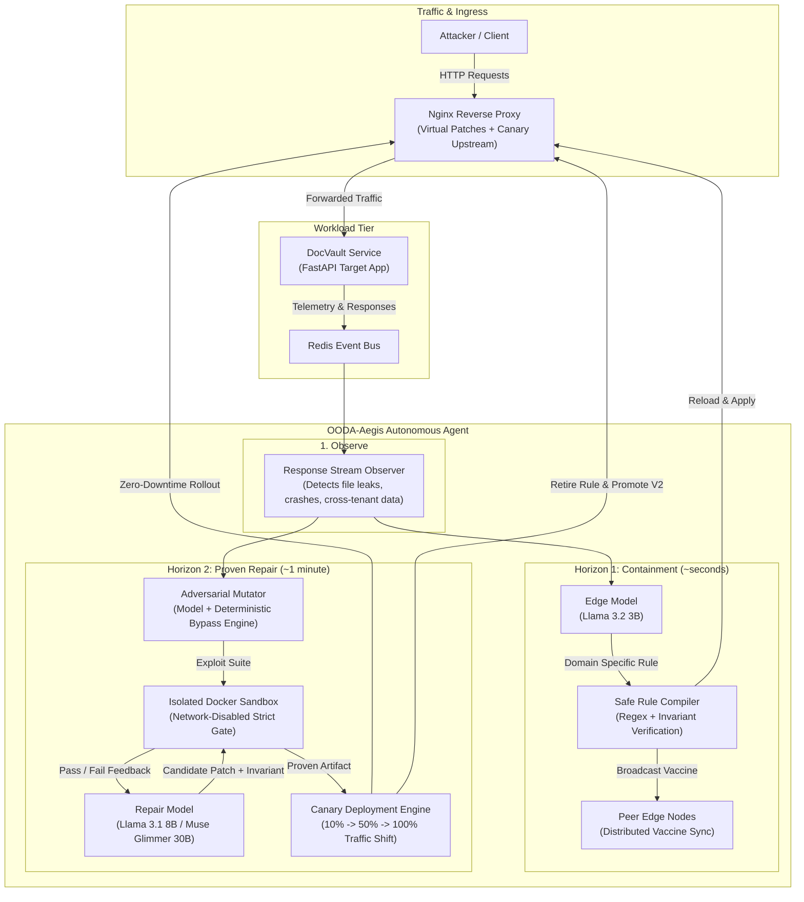
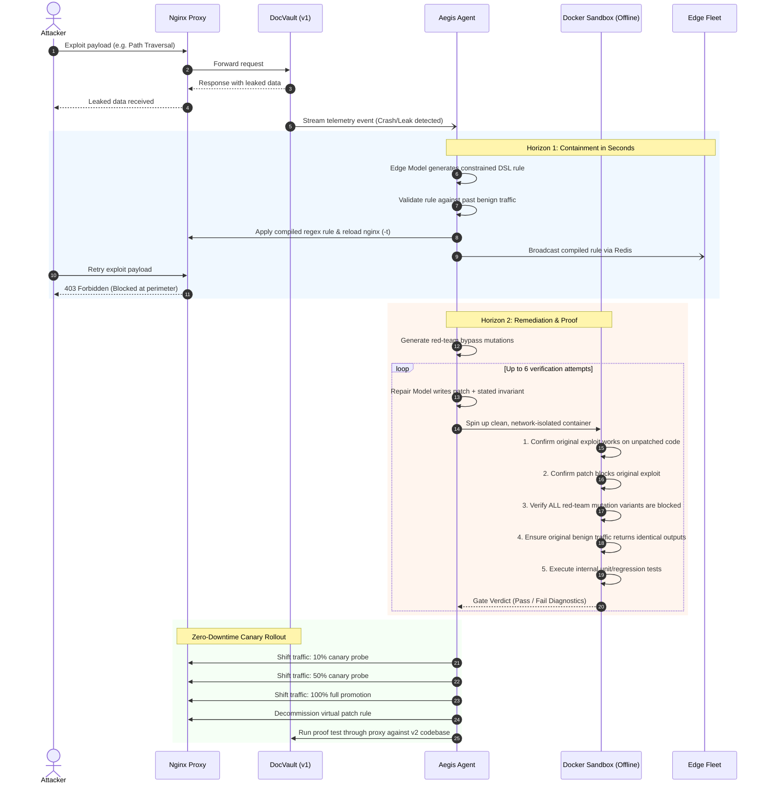

# OODA-Aegis

### When an exploit lands, contain it in seconds and ship a proven fix in about a minute.

An autonomous defense agent that monitors live web services, instantly mitigates active exploits at the proxy layer, then writes, tests, and rolls out a permanent code fix—running entirely on Meta's open-weight models with **zero human intervention**.

[](#how-metas-models-are-used)
[](#how-metas-models-are-used)
[](#how-metas-models-are-used)
[](#built-during-the-hackathon)
[](LICENSE)

**[Watch the Film (2:50)](https://nikhil8557.github.io/ooda-aegis/#demo)** • **[Interactive Replays](https://nikhil8557.github.io/ooda-aegis/)** • **[Benchmark Results](#results)** • **[Run It Yourself](#run-it-yourself)**

</div>

---

## Built During the Hackathon

OODA-Aegis was created by **Nikhil Kumar** for the **Meta Global AI Developer Hackathon 2026** (26 October – 4 November), **Indie track**, under the theme **Build for Your World**. 

While the project started as an early dashboard prototype, the complete end-to-end autonomous agent, vulnerable test harness, verification sandbox, zero-downtime canary rollout engine, Glimmer evaluation harness, and visualizer were built during the final days of the hackathon. Review the complete timeline in the [commit history](https://github.com/Nikhil8557/ooda-aegis/commits/main).

---

## Quick Tour for Judges

| # | Destination | What You Will See |
|---|---|---|
| **0** | **[The Film](https://nikhil8557.github.io/ooda-aegis/#demo)** | **2:50 run.** Narrative walkthrough where every demo clip is an authentic, telemetry-recorded production run from the live agent. |
| **1** | **[Live Dashboard & Replays](https://nikhil8557.github.io/ooda-aegis/app/?replay)** | Replay three full runs frame-by-frame: **Path Traversal** (healed in 42.6 s), **SQL Injection** (healed in 46.3 s), and **ReDoS** (where unverified patches were safely rejected and escalated). |
| **2** | **[Benchmark Suite](#results)** | Comparative analysis of Meta open-weight models across containment and healing phases under a unified verifier. |
| **3** | **[Run It Yourself](#run-it-yourself)** | Run the entire loop locally via `docker compose` and Ollama on consumer hardware. |

---

## The Problem

Every on-call engineer dreads the 3:00 AM incident: an exploit is actively executing in production, data is leaking, and mitigation depends on a fatigued human to write, test, and deploy a hotfix. Industry-standard remediation spans hours or days.

Autonomous remediation typically stalls on two fundamental challenges:

1. **A blocking rule is not a fix.** WAF rules match strings; adversaries mutate them. A rule matching `../../etc/passwd` consistently fails against variants like `....//....//etc/passwd` or URL-encoded paths.
2. **Model-written code cannot be trusted blindly.** LLMs generate plausible patches that often break legitimate workloads, miss boundary conditions, or manipulate test assertions rather than fixing the underlying vulnerability.

---

## What OODA-Aegis Does

OODA-Aegis decouples defense into a two-horizon **Observe → Orient → Decide → Act** feedback loop, guaranteeing that **no LLM-generated artifact ever reaches production without deterministic validation**.

### System Architecture



---

### Dual-Horizon Execution Lifecycle



---

## Detailed Step-by-Step Operation

1. **Observe**  
   Every inbound request and outbound response is continuously streamed to the agent via Redis. Deterministic, low-overhead heuristic checks flag catastrophic events: `/etc/passwd` patterns, token leakage, cross-tenant row exposure, request hangs (ReDoS), or unhandled 500 errors.

2. **Horizon 1: Contain in Seconds (Edge Tier)**  
   The edge model rapidly inspects the breach and emits an abstract virtual patch written in a **strictly bounded DSL** (supporting primitive constraints: `contains`, `max_length`, `repeated_run`).  
   - The agent compiles this into an encoding-aware regular expression (neutralizing evasion techniques such as `%2e%2e%2f`).
   - The expression is proven safe by evaluating it against a history buffer of recorded benign production requests.
   - The agent validates proxy configuration via `nginx -t` and triggers an in-memory graceful reload.
   - The patch is broadcast to peer edge proxies via Redis, where each node independently validates and applies the rule.

3. **Red Team Generation**  
   To prevent false confidence, the edge model and a deterministic mutation engine generate bypass variants across multiple vectors (nested paths `....//`, URL/hex encoding, parameter pollution, SQL dialect variants, recursive string expansions).

4. **Horizon 2: A Formally Proven Fix (Repair Tier)**  
   The repair tier isolates the specific route handler and extracts its full syntax context.
   - The model must first formulate an explicit **security invariant** (e.g., *"Resolved path must reside strictly within target root directory"*).
   - The model generates the patched source file and an accompanying reproduction test.
   - The candidate fix is evaluated within a **throwaway, network-isolated Docker sandbox** across a 5-step gate:
     1. The unpatched code must demonstrably fail against the captured exploit.
     2. The candidate patch must block the exploit.
     3. All synthetic red-team variants must be rejected within a strict 2.5-second SLA.
     4. Existing test suites must pass without regression.
     5. Benign production request logs must execute and return byte-for-byte consistent outputs.
   - If a candidate fails, diagnostics are fed back into the model across up to 6 alternating temperature attempts (`0.2` and `0.8`). If no candidate passes, production source remains unchanged, the edge virtual patch stays active, and an incident is escalated to human operators.

5. **Ship Without Downtime**  
   Once verified, the agent builds a new container image and configures weighted upstream routing in Nginx: **10% → 50% → 100%**. Synthesized canary requests validate the runtime at each stage. A single failed probe instantly triggers rollback to the warm prior container. Upon 100% promotion, the temporary virtual patch is gracefully retired.

---

## How Meta's Models Are Used

| Model | Role | Runtime Environment |
|---|---|---|
| **Llama 3.2 3B** | **Edge Tier**: Real-time triage, safe virtual-patch generation, and red-team exploit mutations. Fast response time (~2s on local hardware). | Open weights via Ollama (Local Laptop / Edge Node) |
| **Llama 3.1 8B** | **Repair Tier**: Root-cause analysis, invariant reasoning, patch synthesis, and test generation. | Open weights via Ollama (Local Laptop) |
| **Muse Glimmer 30B** | **Dual Tier Benchmark**: Evaluated on both edge containment and repair verification. | Official 4-bit GGUF via `llama.cpp` hosted on **two free Kaggle T4 GPUs** |
| **Muse Spark 1.3** | **Optional Cloud Repair**: Alternative repair provider when configured via `MODEL_API_KEY`. | Meta Model API (`https://api.meta.ai/v1`) |

> [!IMPORTANT]  
> **The Case for Local Open Weights in Security:**  
> Autonomous defense systems require access to runtime logs, proprietary source code, and potentially leaked customer data. Transmitting active breach telemetry to third-party APIs during a live incident is unacceptable under most enterprise compliance regimes. Running open-weight models locally ensures zero data leaves your security boundary.

---

## Benchmark Results

All figures reflect empirical data recorded in [`benchmark/results/`](benchmark/results/). Each scenario executes a live exploit against real vulnerable services, runs the four model tasks (triage, virtual patch generation, red teaming, and code repair), and subjects candidates to the isolated Docker sandbox verifier (3 runs per vulnerability).

| Model Configuration | Vulnerability Class | Triage Accuracy | Rule Validated | Edge Rule Bypass Defeat | **Verified Code Fix** | Median Attempts | Median Containment | Median Total Heal |
|---|---|:---:|:---:|:---:|:---:|:---:|:---:|:---:|
| **Llama 3.2 3B** + **Llama 3.1 8B** | Path Traversal (*CWE-22*) | 3/3 | 3/3 | 77% | **3/3** | 3 | 8.7 s | 269.4 s |
| **Llama 3.2 3B** + **Llama 3.1 8B** | SQL Injection (*CWE-89*) | 3/3 | 2/3 | 29% | **3/3** | 1 | 9.7 s | 79.9 s |
| **Llama 3.2 3B** + **Llama 3.1 8B** | ReDoS (*CWE-1333*) | 0/3 | 2/3 | 32% | **3/3** | 1 | 7.2 s | 125.0 s |
| **Muse Glimmer 30B** | Path Traversal (*CWE-22*) | 3/3 | 3/3 | 59% | **3/3** | 1 | 68.2 s | 339.1 s |
| **Muse Glimmer 30B** | SQL Injection (*CWE-89*) | 3/3 | 3/3 | 53% | **3/3** | 1 | 66.1 s | 321.0 s |
| **Muse Glimmer 30B** | ReDoS (*CWE-1333*) | 3/3 | 3/3 | 81% | **3/3** | 1 | 68.2 s | 394.0 s |

### Key Findings

* **100% Verified Fix Rate Across 18 Trials:** Both model configurations successfully cured all 9 multi-vector attacks under strict sandbox conditions. Muse Glimmer 30B achieved zero-shot pass rates (1 attempt needed across all scenarios). Llama 3.1 8B required up to 5 iterative attempts on complex logic, highlighting the critical role of deterministic feedback loops.
* **Models Must Never Grade Their Own Homework:** Candidate tests generated by Llama passed on **0 of its 9 verified fixes** (often asserting incorrect HTTP statuses such as 400 instead of 403, or invalid schemas). Relying on self-evaluation would have resulted in an apparent 0% success rate or accepted broken patches.
* **Perimeter Rules Are Transient:** Virtual patch edge rules stopped only 29% to 81% of adversarial mutations. Complete code-level remediation remains essential.
* **Real-World Laptop Latency:** During standalone runs on an Apple Silicon laptop (M-series, 16 GB), OODA-Aegis contained path traversal in **5.3 seconds** and deployed a verified zero-downtime hotfix in **42.6 seconds**.

---

## Run It Yourself

### Prerequisites

* [Docker Desktop](https://www.docker.com/products/docker-desktop/)
* [Ollama](https://ollama.com/)
* ~7 GB free disk space for model weights
* Tested on macOS (Apple Silicon, 16 GB Unified Memory) and Linux x86_64

### 1. Pull the Models

```bash
ollama pull llama3.2:3b
ollama pull llama3.1:8b
ollama serve
```

### 2. Launch the Infrastructure

```bash
cd infrastructure
docker compose up --build -d
```

### 3. Trigger and Observe

* Navigate to the operator dashboard at **`http://localhost:3030`**.
* Select a vulnerability target and click **Fire Attack**.
* Watch the agent triage, compile the edge rule, run sandbox verification, and execute canary promotion with zero human intervention.

To trigger an exploit directly from your terminal:

```bash
# Path traversal attack against public ingress (port 8080)
curl "http://localhost:8080/api/v1/documents/read?file=../../../../etc/passwd"
```

To reset the environment back to the unpatched release, click **Reset** in the dashboard UI.

---

## Advanced Options & Benchmarking

* **Using Glimmer / Cloud APIs:** Copy `.env.example` to `.env` and set `GLIMMER_BASE_URL` to route requests to an external `llama.cpp` server, or supply `MODEL_API_KEY` to leverage the Meta Model API.
* **Run Local Benchmarks:**
  ```bash
  python benchmark/run_benchmark.py --trials 3
  ```
* **Run Kaggle T4 Benchmark:**
  Use [`benchmark/kaggle/make_kernel.py`](benchmark/kaggle/make_kernel.py) to package the evaluation job for dual-GPU environments.
* **Exporting Session Runs:**
  ```bash
  python tools/export_replay.py latest <run_name> "<Human Readable Description>"
  ```

---

## Technical Scope & Boundaries

* **Real Implementations:** The vulnerable FastAPI target (`DocVault`), vulnerability mechanics, live Nginx dynamic reconfiguration, Redis telemetry pipelines, multi-container edge mesh, zero-network Docker execution sandboxes, progressive canary deployment, and automated rollbacks are fully functional.
* **Simulated Scope:** Customer records and credentials within `DocVault` are synthetic mock fixtures. Vulnerabilities represent canonical CWE patterns rather than active zero-days in third-party software. The distributed edge mesh runs locally within a single Docker network topology.
* **Operational Constraints:** Benign request regression verification depends on representative historical traffic samples. Route remediation is presently constrained to the file boundary containing the triggered handler.

---

## Repository Structure

```
├── infrastructure/
│   ├── app/            # DocVault: Target service with real CWE vulnerabilities & test suites
│   ├── agent/aegis/    # Core Agent logic
│   │   ├── engine.py   # Primary OODA state loop coordinator
│   │   ├── detect.py   # Telemetry heuristics & breach classification
│   │   ├── llm.py      # Provider adapters (Ollama, Glimmer, Meta API)
│   │   ├── prompts.py  # Prompt contracts for triage, rules, invariants, & repairs
│   │   ├── verify.py   # Isolated Docker verification test gate
│   │   ├── infra.py    # Nginx hot-reloading, upstream switching, & Docker orchestrator
│   │   └── server.py   # Live SSE streaming & agent control API
│   ├── proxy/          # Nginx gateway definitions, templates, and dynamic include slots
│   ├── fleet/          # Mesh peer node daemon for synchronized edge vaccine testing
│   └── dashboard/      # Production container build serving the management UI
├── src/                # React dashboard source (real-time stream + frame-by-frame replay engine)
├── benchmark/          # Automation suites, Kaggle job compilers, and raw trial telemetry
├── tools/              # Replay packagers, headless attack scripts, and asset generation tools
├── docs/               # Production build deployed to GitHub Pages
└── video/              # Demo video source assets, score, scripts, and automation recipes
```

---

## Credits

Engineered by **Nikhil Kumar**.

* **Model Providers:** Meta Llama 3.2, Llama 3.1, and Muse Glimmer (utilized under Meta's Community License).
* **Core Stack:** FastAPI, Nginx, Redis, Docker, Ollama, llama.cpp, React, Vite, TailwindCSS.
* **License:** [MIT](LICENSE)
